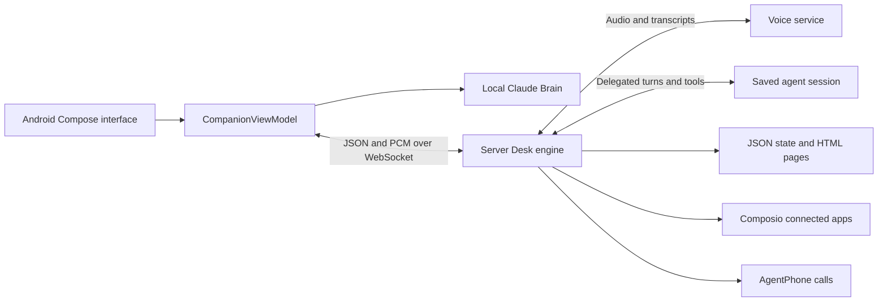

# Desku architecture and Desk Buddy rebuild reference

Desku turns a spare Android phone into a stationary AI desk companion. Its animated blue character listens, speaks, sees the desk, helps choose a focus, remembers requested details, and follows up. Recreating the current product requires the Android app, its optional server engine, the agent definition, the web interfaces, and the operating scripts.

This reference describes source at commit `2aea122`, reviewed on October 8, 2026. Model names and dependency versions below are values configured in this repository; their availability has not been checked against live providers. The function index remains in the original Desku repository at `docs/FUNCTION_INDEX.md`; source modules listed here refer to that baseline repository.

## Product and repository structure

| Location | Responsibility |
| --- | --- |
| `app/` | Native Android kiosk, Compose interface, avatar, camera, microphone, speaker, preferences, local Claude mode and server device mode. |
| `server/` | TypeScript engine, voice gateway, persistent agent session, tools, scheduling, application connections, calls, generated pages, browser client and dashboard. |
| `agent/` | Saved agent definition and a separate Bash terminal client. |
| `design/handoff/` | Original HTML design directions and generated design-preview runtime. |
| `docs/screens/` | Six historical Android screenshots; later source changes supersede some layouts and labels. |
| `demo/` | Handwritten task-list photo used by demo and smoke scripts. |
| `scripts/` | Android demo, wake model download/check, avatar generation, engine keeper and laptop/cloud migration. |
| Root Gradle files | Android dependency catalog, build and wrapper configuration. |
| `Dockerfile`, `fly.toml` | Container and single-machine Fly engine deployment. |
| `.agents/skills/`, `.claude/skills/`, `skills-lock.json` | Development assistant integration instructions; not application runtime features. |

Branding is Desku, the Gradle project is `DeskBuddy`, and the Android namespace/application ID is `com.deskbuddy`. The app and server are version `0.1.0`. The source is MIT licensed; preserve its notice if copying substantial portions.

## The two operating modes

`Settings.serverUrl` selects the mode. A blank address uses Claude directly on the phone. A configured address makes the phone a device for the engine. The modes share the interface and hardware but have different capabilities and persistence.

| Concern | Phone only | Engine connected |
| --- | --- | --- |
| Brain | Official Anthropic Java SDK, configured default `claude-opus-5-5`. | Saved OpenAI Agents API agent, configured `gpt-6-astra`, low reasoning effort. |
| Incoming speech | Android `SpeechRecognizer`, possibly network-backed. | Raw microphone audio streamed to configured `gpt-live-1`. |
| Outgoing speech | Android `TextToSpeech`. | Streamed PCM from the voice service. |
| Conversation | In-process, expires after 10 quiet minutes. | Hosted agent session persists across voice sessions and engine restarts through its saved ID. |
| Saved memory | Phone-private `memories.json`. | Engine `data/desku.json`; phone displays remote memories. |
| Focus timing | Coroutine timer in the ViewModel; not persisted. | Persisted focus and check-ins; engine polls every five seconds. |
| Structured answers | Lists, highlighted suggestions and up to three choice buttons. | Generated HTML pages plus the deterministic Today page. |
| Web/apps/calls | No corresponding tools. | Hosted web search, optional Composio and AgentPhone. |
| Listening | Talk/wake phrase, followed by brief follow-up listening. | Continuous voice session by default; `ALWAYS_LISTEN=0` enables demand-based sessions. |

## Features and user interactions

| Feature | Behavior and implementation |
| --- | --- |
| Desk character | Canvas-drawn blob with glasses, white eyebrows and mustache. Six expressions: dozing, listening, thinking, talking, muted and peeking. Blinks, breathes, bobs and follows the user's horizontal position. |
| Voice conversation | Talk/Stop button, captions, audible listening chime, short conversational answers. Listening, thinking and speaking use a stable shared layout. |
| Voice animation | Microphone energy changes the glow; engine playback energy drives the mouth and aura according to the scheduled playback time. `VoiceBeam` adds a blue, violet and teal glow. |
| Wake phrase | Vosk recognizes eight phonetic variants of “Hey Desku” at 16 kHz with near-miss decoys. Requires the separately downloaded model. |
| Continuous camera | CameraX analysis and still capture run while the activity is visible and camera permission/switch permit it. Built-in Android face detection runs about every 900 ms. No preview is shown during normal presence monitoring. |
| Presence | Local eyes follow the user and doze when absent. Detection holds a face for four seconds; the ViewModel additionally waits 15 seconds before reporting absence to the server. |
| Looking at objects | Instant snapshot from the active camera; otherwise a three-second preview/countdown fallback. JPEG is rotated upright, capped at 1280 px and encoded at quality 80. Engine snapshots close after roughly 3.5 seconds. |
| Explicit memories | Saves require a matching request or a yes to an offer, enforced by Kotlin/TypeScript policies. Memories have IDs, timestamps and up to 500 characters. |
| Forgetting | Delete one memory with a five-second Undo window; leaving the screen commits it. Delete all requires a UI confirmation. Voice deletion resolves through the brain tools. |
| Focus | Pick a task, start a timer, show a countdown, chime and ask how it went. Check-in buttons offer Done, 10 more minutes, or Switch task. |
| To-dos | Engine tools add, complete or remove tasks by ID or matching words. No independent local to-do store. |
| Today | Engine builds a page directly from stored to-dos, focus, check-ins and memories; no model call is needed. Changes update the same page ID. Arrival can show it automatically. |
| Welcome back | Engine can greet the user after at least 10 minutes away, with a focus set and no active voice session; limited to once every 30 minutes. Continuous listening normally prevents this condition. |
| Connected apps | Optional Composio session exposes tool discovery, schemas, execution and authorization. Connect through the dashboard or an authorization link. |
| Calls while away | Optional AgentPhone calls for due check-ins when offline, absent by camera for over two minutes, or silent after a check-in for the configured wait. Two-minute offline grace after engine startup. |
| Calls on request | Can call the owner or a US/Canada number on their behalf. External-number validation and a broad call-request gate are enforced; exact number readback/confirmation is a prompt rule. |
| Generated pages | Agent writes HTML for schedules, tickets, travel, comparisons and other visual answers. WebView opens it above the companion, with a small face and live caption strip. |
| Privacy switches | Microphone mute, camera off, wake phrase switch, visible camera/mic status and permission errors. Android mute stops mic capture; the browser test client only suppresses transmission. |
| Kiosk | Fullscreen, screen awake, launcher option, ordinary screen pinning or full device-owner lock task. Hidden five-second top-edge hold opens PIN-protected administration. |
| Wi-Fi | Device owner can scan and join open/WPA2/WPA3 networks within the app; alternate path opens Android Wi-Fi settings with PIN. |
| Ambient display | Dims the backlight to 2% after three idle minutes. Interaction or speech brightens it. Pages/check-ins prevent dimming. |
| Optional video face | Four local silent H.264 loops and a poster can replace the blob. Missing assets fall back to the drawn character. Video talking is a loop, not word-level lip sync. |

## Android modules and functions

| Module | Main operations and relationships |
| --- | --- |
| `MainActivity.kt` | Builds Compose content, requests microphone/camera permissions, applies fullscreen/brightness behavior, forwards lifecycle events, enters kiosk on resume, registers debug-only broadcasts and supplies kiosk hooks. |
| `CompanionViewModel.kt` | Owns `UiState`, settings, memories, camera, local brain, wake recognizer, engine socket and audio. Routes buttons, controls listening/speaking, executes camera requests and local timers, translates engine messages into screen state. |
| `Settings.kt` | Reads/writes private SharedPreferences and exposes reactive `Prefs`. Provides brain settings and initial debug defaults. |
| `brain/Brain.kt` | Serializes turns with a mutex, builds frozen conversation prompts, appends history, executes up to six model/tool rounds, returns speech/cards, and restores conversation history after failure or cancellation. Tool side effects are not rolled back. |
| `brain/Prompt.kt` | Builds initial system prompt and memory snapshot; appends changing time/camera/timer/memory status on each new user turn to preserve the cached prefix. |
| `brain/SpeechText.kt` | Strips markdown and code blocks that should not be spoken. |
| `memory/MemoryPolicy.kt` | Regex-based permission to save, excluding memory questions and recognizing affirmative answers to memory offers. |
| `memory/MemoryStore.kt` | Loads, adds, deletes and clears memory entries, emits StateFlow updates and writes through a temporary file. |
| `voice/Ears.kt` | Creates a fresh Android speech recognizer per utterance; emits partial/final text, level, silence and readable errors. |
| `voice/Voice.kt` | Initializes TTS, chunks long speech, waits for utterance completion, stops speech and produces listening/timer chimes. |
| `voice/WakeWord.kt` | Unpacks bundled Vosk model, starts/stops local recognition and matches variants. Releases the mic before conversational listening. |
| `camera/AlwaysOnEyes.kt` | Binds camera to lifecycle, analyzes faces, smooths coordinates and takes instant stills. |
| `camera/CameraFeed.kt` | Preview/countdown fallback using a deferred `LookRequest`; common image-to-JPEG conversion. |
| `engine/EngineLink.kt` | OkHttp WebSocket, 20-second ping, reconnect backoff from one to 30 seconds, JSON dispatch, binary PCM and relative-page URL resolution. |
| `engine/LiveAudio.kt` | Duplex 24 kHz AudioRecord/AudioTrack, voice communication routing, echo cancellation/noise suppression, speaker queue, loudness and interruption flush. |
| `kiosk/DeskuAdmin.kt` | Android device-admin receiver used for device ownership. |
| `kiosk/KioskPolicy.kt` | Applies lock-task/home/system restrictions and checks the compiled admin PIN for Wi-Fi/settings exit operations. |
| `kiosk/WifiSetup.kt` | Grants scanning prerequisites as device owner, lists strongest networks, reports current Wi-Fi and attempts joining for about 20 seconds. |
| `ui/Screens.kt` | Chooses idle/conversation/camera/check-in/memories screens, overlays pages, binds camera lifecycle, handles hidden admin gesture, renders dock, list choices, memory deletion/Undo and privacy controls. |
| `ui/Night.kt` | Palette, bundled Figtree/DM Mono typography, Canvas glyphs, pills, status chips, switches and dashed borders. |
| `ui/Desku.kt` | Expression geometry and animation; draws body, glasses, pupils, brows, cheeks, mouth and mustache. |
| `ui/Avatar.kt` | Selects drawn/video face, verifies five assets, shares ExoPlayer and switches loops/poster by state and size. |
| `ui/VoiceBeam.kt` | Audio envelope with fast attack/slow decay; moving glow while thinking. |
| `ui/PageOverlay.kt` | JavaScript-enabled WebView with file access disabled and mixed content refused; main navigation stays on the engine origin. |
| `ui/SettingsDialog.kt` | Engine address/token, Anthropic key/model, wake phrase, lens, new conversation and screen-pinning settings. |
| `ui/AdminDialog.kt` | PIN checks and routes to Wi-Fi, settings or kiosk unlock. |
| `ui/WifiPanel.kt` | Nearby-network selection, manual SSID/password input, password visibility and join progress. |

`UiState` modes are Idle, Listening, Thinking, Speaking and Looking. Separate flags track camera, memories, check-ins and pages. Screen priority is memories → camera → check-in → conversation → idle; a page overlays the result. The last spoken reply keeps the conversation screen visible for 60 seconds. Mode delays reduce flicker; idle remnants clear after 90 seconds.

## Server modules and functions

| Module | Main operations and relationships |
| --- | --- |
| `src/index.ts` | Initializes config/store/pages/apps/agent/Desk; serves HTTP, applies token checks, upgrades `/device`, exposes overview and app/page operations, starts scheduler and handles shutdown. |
| `src/config.ts` | Required environment validation and defaults, including continuous listening, timezone, idle timeout and optional integrations. |
| `engine/Desk.ts` | Single-device coordinator: attaches/replaces sockets, routes mic/JSON messages, opens voice sessions, handles delegation, taps, presence, tools, photos, due check-ins and calls. |
| `engine/tools.ts` | Tool context and dispatcher; validates arguments, enforces memory/call gates and connects model actions to stores/device/integrations. |
| `engine/today.ts` | Escaped HTML render of current tasks/focus/memories and a check-in countdown. |
| `brain/AgentBrain.ts` | Hashes/synchronizes saved agent definition, queues turns, creates/reuses hosted sessions, processes streamed actions, submits idempotent tool results, retries once for unusable sessions and times out after 150 seconds. |
| `brain/MemoryPolicy.ts` | Server memory gate; checks sentences separately and uses recent assistant speech to recognize an offer. |
| `live/LiveClient.ts` | Voice WebSocket transport, startup command queue, event parsing, PCM/base64 conversion, commentary vs silent context, mute/unmute, close and 1800-character append limit. |
| `live/Transcript.ts` | Merges speaker fragments, gathers user words since delegation, retains up to 200 turns and returns recent context/consent phrases. |
| `live/prompt.ts` | Voice persona, interruption behavior, delegation policy, time/focus context and brief-answer rules. |
| `store/Store.ts` | Atomic JSON state, change notifications, memory/focus/todo/check-in operations, agent links and incoming migration-state adoption. |
| `apps/Apps.ts` | Creates/reuses Composio session, adapts tool definitions, excludes remote shell/workbench, authorizes apps, lists connections, runs tools and extracts authorization links. Outputs capped at 12,000 characters. |
| `phone/AgentPhone.ts` | Resolves caller number/agent, places hosted AI call, polls every five seconds and retrieves transcript. Attempts to end calls still active after 20 minutes. |
| `pages/Pages.ts` | Random page IDs, HTML/index persistence, update/delete, 512 KB limit, newest 50 retention, CSP headers and UI-kit injection. |
| `pages/kit.css`, `kit.js` | Dark page styling, cards/stats/lists/timelines/tables/travel passes, timestamps, countdowns, progress and animated flight routes. |

The backend is a single Node process with filesystem storage. It has no database server, login system, tenant model, background queue service, React frontend or ORM.

## Model tools

The local Claude brain defines six tools: `look_through_camera`, `save_memory`, `delete_memory`, `start_focus_timer`, `cancel_focus_timer`, and `show_on_screen`. When a response contains speech and only `show_on_screen`, the screen displays immediately and tool results are deferred until the next user message to avoid an extra model request.

The engine's agent defines 12 function tools plus hosted web search:

| Tool | Effect |
| --- | --- |
| `get_desk_status` | Returns local time, current/recent focus, memories, open/recently done to-dos, check-ins, camera and presence. |
| `set_focus` | Records/replaces focus, cancels earlier focus check-ins and optionally adds one. |
| `save_memory`, `delete_memory` | Persist an explicitly requested detail or remove an ID. |
| `look_through_camera` | Requests one device photo and returns an image content block to the agent. |
| `call_phone` | Starts owner/third-party call and reports results asynchronously. |
| `control_desk` | Camera on/off/close, mute mic, show/hide memories, end conversation. |
| `show_page` | Stores agent-written HTML and announces a new or updated page. |
| `add_todo`, `complete_todo`, `remove_todo` | Edit task list and refresh Today. |
| `show_today` | Shows the deterministic stored-data page. |

Composio dynamically adds its supported meta tools. The expected set includes search, schemas, multiple execution and connection management; the implementation filters only its remote bash and workbench tools.

The Bash terminal client uses the same agent definition but implements only desk status, focus, saving and deleting memory. It rejects camera/apps/calls/pages/controls and does not implement the added to-do tools. Its memory consent rule is prompt-only.

## Voice and camera data flow

In engine mode the device sends raw mono, little-endian PCM16 at 24 kHz in roughly 100 ms binary frames. The engine forwards permitted audio to the voice service, collects transcript deltas and waits 400 ms when a delegation arrives so trailing words can land. It gives the agent the user request and recent context. Agent tools execute on the engine; the final answer goes back to the voice service as commentary to speak.

Only camera-related progress is normally spoken while a tool runs; other progress is quiet voice context. Barge-in sends `interrupt` when user text arrives within three seconds of outgoing voice, throttled to once per second. Android flushes queued audio and animation timing.

A camera tool creates a request ID and asks the device for a snapshot. Photo/error replies complete that request, with a 20-second server timeout. Face-analysis frames stay on the phone; requested snapshots are sent to the selected brain.

## Device and HTTP contracts

The device connects to `/device?token=...`. A matching shared token is required; connecting another device replaces the previous device. Tokens are compared with `timingSafeEqual` after a length check.

| Direction | JSON messages |
| --- | --- |
| Device to engine | `start`, `stop`, `mute`, `unmute`, `camera`, `photo`, `photo_error`, `forget`, `forget_all`, `say`, `presence`. |
| Engine to device | `state`, `transcript`, `desk`, `capture`, `checkin`, `link`, `calling`, `error`, `control`, `page`, `interrupt`. |

| Route | Behavior |
| --- | --- |
| `/` | Plain HTML browser device client; connects mic and plays streaming audio. |
| `/agent`, `/agent.html` | Token-gated dashboard showing connections, focus/history, check-ins, memories, pages, tools, IDs and agent instructions. Polls every five seconds. |
| `/healthz` | Simple `ok` response; does not check upstream provider readiness. |
| `GET /api/overview` | Bearer token required; returns dashboard data; connection data cached up to 30 seconds unless authorization is pending. |
| `POST /api/apps/connect` | Bearer token required; `{app: toolkitSlug}` returns an authorization URL. |
| `GET /p/<id>` | HTML page readable by possession of its random 128-bit link; no device token needed. |
| `DELETE /api/pages/<id>` | Bearer token required; deletes HTML and metadata. |

Loopback requests using a localhost Host receive the token injected into HTML/localStorage. This is a convenience for local development. The dashboard can connect apps and delete pages, so it is not entirely read-only despite the README description.

Pages use an opaque-origin CSP sandbox, disallow fetch/form submission and allow selected script/font CDNs. Popups may escape the sandbox. Android restricts main navigation to the engine origin. The browser client does not implement all Android features: no presence, no audio interruption flush, no matching local mic-release behavior.

## Storage and privacy boundaries

| Data | Location and lifetime |
| --- | --- |
| Phone preferences | Private SharedPreferences: API key, model, engine URL/token, switches and lens. No explicit encryption layer. |
| Local memories | Private phone JSON until deleted; local conversation content is in memory. |
| Local focus timer | ViewModel memory; process death loses it. |
| Engine state | `data/desku.json`: memories, focus/history, check-ins, to-dos, agent/session hashes/IDs, Composio session and Today page ID. |
| Engine pages | `data/pages/<id>.html` and index metadata. These may persist application-derived personal information. |
| Hosted brain history | Remote Agents API session. Saving only explicit memories does not imply forgetting hosted conversation history. |
| Voice transcript buffer | Engine memory; server logging also emits delegated requests and brain answers. Log retention depends on operation/deployment. |
| Phone call data | Passed to AgentPhone; transcript returned to the engine and sent to the hosted brain. |
| Terminal state | `agent/state/desk.json` and IDs; separate from engine and phone state, with seconds/snake_case fields. |

Deleting a memory removes its entry in the selected store. It does not purge hosted session history, logs, existing generated pages or backups. The app disables Android backup, but this does not cover server/cloud copies.

## Tech stack and build configuration

| Area | Repository configuration |
| --- | --- |
| Android language/toolchain | Kotlin 2.2.10 through AGP 9.1.0 built-in Kotlin, Gradle 9.7.1, Java source/target 17. |
| Android support | minSdk 26, compileSdk/targetSdk 36. |
| UI/state | Jetpack Compose BOM 2026.06.01, Material 3, lifecycle 2.10.0, coroutines 1.10.2 and StateFlow. |
| Hardware/media | CameraX 1.4.2, Vosk 0.3.75, JNA 5.18.1 AAR, Media3 1.11.1, Android audio/speech APIs. |
| Android networking | Anthropic Java 2.68.0 and OkHttp 4.12.0. |
| Server language | TypeScript with strict NodeNext configuration, ES2023 target, no emit; `tsx` executes source. |
| Server runtime | Package declares Node >=22; locked Composio packages require >=22.22.3. Container is `node:22-slim`. |
| Server packages | Locked OpenAI 7.28.0, Composio core 0.22.0, ws 8.22.0; tsx and TypeScript dev tools. |
| Browser interfaces | Plain HTML/CSS/JavaScript and Web Audio API. React/Babel in generated design `support.js` belong to the prototype runtime only. |
| Testing | Android JUnit 4, coroutine test tools, MockWebServer and real JVM JSON; server Node test runner through tsx with fake services. |
| Operations | Docker/Fly, Bash, adb, curl, jq; optional LivePortrait/Python/ffmpeg for avatars. Several scripts assume macOS utilities and SDK paths. |

Android debug builds may embed key/address/token defaults from ignored `local.properties`; the kiosk PIN is compiled into both build types. Release does not embed provider/token defaults. Release minification is off and no release signing configuration is supplied. Release blocks general cleartext networking but explicitly permits localhost, 127.0.0.1 and emulator 10.0.2.2; debug permits cleartext generally.

Fly configuration uses one always-on machine in `ewr`, 512 MB RAM, port 8787 and a mounted data volume. The design requires a single engine writer/device; horizontal scaling is not supported. Migration scripts transfer JSON/pages between laptop/cloud and stop the other engine to prevent duplicate scheduling and state divergence.

## Scripts and assets

| Script/resource | Purpose and conditions |
| --- | --- |
| `scripts/demo.sh` | adb typed demo and screenshots; waits for local-mode debug log markers, so its completion detection is not suitable for engine mode. |
| `scripts/fetch-wake-model.sh` | Downloads `vosk-model-small-en-us-0.15`, installs it under Android assets and writes its unpack version UUID. |
| `scripts/check-wake-word.sh` | macOS synthetic speech across six voices/ten phrases and Vosk matching; useful smoke coverage, not room-microphone validation. |
| `scripts/make-avatar.sh` | Local LivePortrait driving clips, crop/scale and forward/reverse 480 px H.264 loops, plus poster. Optional external model setup. |
| `scripts/start-desku.sh` | Restarts local engine and repairs adb reverse when USB reconnects. |
| `scripts/switch-to-cloud.sh`, `switch-to-laptop.sh` | Fly deployment/data handover/device address rewrite; assume debug app `run-as` and macOS conveniences. |
| `server/scripts/usb-bridge.ts` | Relays device WebSocket and HTTP to a cloud engine through laptop USB forwarding. |
| `server/scripts/fake-phone.ts` | Uses macOS synthetic speech and fixture photo against real voice/brain, saves WAV output. |
| `server/scripts/smoke-brain.ts`, `smoke-apps.ts`, `smoke-page.ts` | Live provider checks; can synchronize a supplied saved agent and exercise actual tools. |
| `server/scripts/connect-app.ts`, `call-me.ts` | Actual app authorization and actual owner-phone call. |
| `agent/desku.sh` | Terminal commands to create/start/chat/tick/status/items/cancel/end; curl/SSE, retries and idempotent tool results. |

Bundled fonts, launcher XML, demo photo and screenshot references are committed. The Vosk model directory and optional avatar directory are absent from this checkout. The design contains three directions: Nightlight, Sticker and Peekaboo. Production follows Nightlight; the other directions are references, not selectable app themes.

## Differences and gaps to preserve consciously

1. **Continuous listening is already implemented and defaults on.** README/dashboard/privacy labels and the agent's statement that it cannot listen in the background are inconsistent with foreground continuous streaming. `ALWAYS_LISTEN` is absent from the sample environment file.
2. **Engine integration and interruption flush are implemented.** The server README still lists these as unfinished. “Built in source” does not establish successful live testing in this review.
3. **Cancel/finish focus lacks agent tools.** `Store.cancelCheckins()` is only used by `set_focus`; `finishFocus()` has no runtime caller. The phone sends a natural-language cancellation request, but there is no explicit cancel/complete focus tool. A replacement focus with no check-in can cancel earlier check-ins, but this is not a complete stop/finish API.
4. **New conversation affects only local Brain.** In engine mode the setting clears screen text but does not reset/delete the hosted session. Separate mode semantics must be explicit in a rebuilt app.
5. **Welcome-back normally cannot run with continuous listening.** Its guard requires no active voice session, whereas default listening keeps one open. Today arrival display has a separate path and can still work.
6. **Consent enforcement differs by action.** Memory save has a code gate. Composio writes rely on instructions. Third-party calls have a broad request gate, not a binding approval for an exact number/message. The terminal memory tool has no code gate.
7. **Automatic local events retain previous user words.** The local memory gate uses the last spoken turn even for later timer events. Its intent is explicit latest-turn consent, but automatic events do not clear that context.
8. **Check-ins are marked fired before successful delivery.** Quiet-hours suppression, another in-progress call or delivery failure can consume a check-in without retry. Multiple due calls are limited by the single-call flag.
9. **Mute and lifecycle need separate verification.** Android releases its mic when muted. The browser leaves the media stream open. Background/foreground pause, reconnect, server-state synchronization and playback queue races need device testing.
10. **Persistence is intentionally small and single-user.** JSON parse/load errors reset to empty state; no schema migration/versioning, encrypted secret store, multi-user authentication or reliable background job service is present.

These are implementation findings for the rebuild, not changes made to the current application.

## Verification status

There are 42 server test declarations across six files and 13 Android JUnit tests across two files. They cover voice/delegation, memory gates, camera, scheduling/offline/away behavior, Composio routing, page persistence/kit/CSP, always listening, interruption, presence, Today, local SDK request handling and append-only history.

Checks attempted in this checkout:

| Command | Result |
| --- | --- |
| `npm test` in `server/` | Could not execute: `tsx` is not installed. |
| `npm run typecheck` in `server/` | Could not execute: `tsc` is not installed. |
| `./gradlew :app:testDebugUnitTest` | Could not execute: Java is missing and JAVA_HOME is unset. |
| Dependency-free syntax/configuration checks | Passed: eight Bash scripts, page-kit and browser inline JavaScript, repository configuration JSON and Android XML. |

The available Node version is 20.20.2, below the server requirement. adb is not on PATH. No live API credentials, calls, account connections or deployments were exercised. Source tests and historical README reports do not establish current runtime success. Baseline syntax/config checks can run without provider access; full parity requires dependency setup and an Android device or emulator.

## Rebuild sequence and parity criteria

Treat the current source behavior as the baseline, with the differences above tracked explicitly. Recreate both operating modes if the target is identical to the whole project. Model replies themselves are nondeterministic, so parity means equivalent workflows, tools, state rules and visual behavior, not identical words on every run.

1. Create a fresh repository and its Android/server build foundations, preserving license attribution where source/assets are reused. Choose independent app/deployment/account identifiers before installation or provider provisioning.
2. Reproduce Nightlight tokens, fonts, drawn character, expressions, stable conversation layout, dock, memories/privacy, camera and check-in screens.
3. Implement local preferences/memory policy/store, speech recognition/TTS, Vosk wake phrase, CameraX presence/snapshot, local Claude tool loop and timer.
4. Implement engine store/tools, device protocol, voice transport, hosted brain lifecycle, delegation and streaming audio. Test fake-device flows before introducing paid providers.
5. Add Today/to-dos, generated page storage/kit/WebView, presence events, check-ins and reconnect behavior.
6. Add optional Composio authorization/tool routing and AgentPhone scheduling/transcript processing with independent accounts and numbers.
7. Add kiosk ownership/PIN/Wi-Fi, USB bridge, deployment configuration and operating scripts appropriate to the development host.
8. Validate source tests, real phone mic/echo/barge-in, wake phrase in a room, permission/privacy switches, process restart/offline check-ins, kiosk recovery, and visual parity against current source plus historical references.

Acceptance scenarios: talk and interrupt; show a handwritten list; select focus and receive a due check-in; explicitly save/recall/delete memories; reject unsolicited memory saves; toggle camera/mic honestly; add/complete/remove tasks and refresh Today; generate/update/delete a page; connect an app and read requested data; place requested/away calls under configured rules; reconnect after network loss; persist engine state after restart; enter and exit kiosk via the admin flow.

The new repository should carry source/assets/config examples and tests. Use new secrets, saved agent/session IDs, owner identity, Composio user, phone number and Fly app/volume; existing account identifiers and private state are not a reusable product template.
